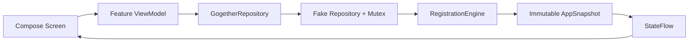

# Architecture

> 2026-11-20：当前 ABCDE 本地集成的字段映射、E 私有存储和数据迁移见 [INTEGRATION_A_B_C_D_E](INTEGRATION_A_B_C_D_E.md)。主业务仍共用一个 Repository，E 的签到/评价通过活动实例键和适配器连接，不把私密评论或图片复制到主快照。

## 数据流

单一 `app` 模块，以 Feature Package 分工。`GogetherApplication` 在应用进程内持有唯一 Repository。页面依赖参数和回调，ViewModel 负责异步命令与操作反馈。`collectAsStateWithLifecycle` 将共享快照映射到可见 UI。没有页面自行保存报名名单或人数副本。

Explore 的 ViewModel 通过 `combine` 合并仓库快照、筛选条件与本地时钟；页面可在达到截止时刻时更新按钮。真正执行操作时，引擎再次读取时钟并校验，避免只依赖按钮是否启用。

## 事务边界

`FakeGogetherRepository.mutate` 使用 Mutex 串行执行本地命令。引擎在全部校验通过后才替换快照；取消、转正和通知使用同一个 `copy` 发布。UI 不会观察到“取消已生效、转正尚未生效”的中间结果。

这只适用于一个进程。正式后端必须将容量检查、唯一报名约束、取消、首位候补选择和通知记录放在可信事务中，并用幂等请求 ID 处理重试。客户端提交的 actor ID、队列顺序和时间不可信。

## 状态与约束

| 情境 | 引擎行为 |
| --- | --- |
| 创建活动 | 校验字段，组织者产生一条 CONFIRMED 报名，占一个名额 |
| OPEN、未开始且未截止 | 有空位则 CONFIRMED，否则 WAITLISTED |
| 已 CONFIRMED / WAITLISTED | 拒绝重复报名，无状态变更 |
| 正式参与者取消 | 标记 CANCELLED；若仍可报名，首位候补变为 CONFIRMED 并收到通知 |
| 候补取消 | 从有效队列移除，不释放正式名额 |
| 取消后重新报名 | 同一用户 / 活动记录复用 ID，重新分配 joinedAt 与队列序号，排到队尾 |
| now >= deadline | 禁止报名和补位；开始前仍允许参与者取消 |
| now >= start | 禁止新报名、参与者取消和组织者取消 |
| 活动 CANCELLED | 清除所有有效报名状态、关闭签到、通知所有原参与者；不补位 |
| COMPLETED 或超过 endAt | 禁止新报名 / 签到，允许合格参与者提交一次反馈 |

队列使用单调递增 `queueOrder`，保证同一毫秒加入时也有明确顺序。正式人数和候补人数从报名记录派生，避免重复字段失配。`RegistrationStatus.REJECTED` 是预留状态；第一阶段失败命令返回 `Result.failure`，不保存被拒绝记录。

## 时间、签到与反馈

所有模型时间用 epoch milliseconds。创建和编辑表单严格解析设备时区的 `YYYY-MM-DD` 和 `HH:mm`，拒绝不存在的日期以及夏令时重叠 / 跳过的模糊时间。表单明确显示时区；组织者填写结束时间，活动最长 24 小时。终止时间到达后 UI 通过 `statusAt` 派生为已结束；本地不会自动把存储的 OPEN 重写为 COMPLETED。

Demo 签到默认启用，要求当前用户存在且已登录、正式报名、此前没有签到、活动未取消 / 未结束，并处于 `[startAt - 30 分钟, startAt + 30 分钟]`（两个端点包含）。到达 `endAt` 或标记 COMPLETED 时沿用已有结束限制，即使窗口尚未到期也停止签到；取消活动立即停止签到。没有独立的手动签到开关。本次不扩大组织者取消权限，开始后取消活动仍待 B 确认。

E 的 `feature/checkin/CheckInWindow.kt` 与 `CheckInEligibility.kt` 统一页面状态和提交校验；`RegistrationEngine.checkIn` 在现有 Repository Mutex 内读取一次时间，按最新快照检查并写入该时间。页面沿用现有每秒时间流更新；即使页面提示尚未刷新，提交仍重新校验。签到记录在活动取消后保留，窗口过期不自动产生缺席或处罚。

接口迁移：移除 `Event.demoCheckInOpen`、`GogetherRepository.setDemoCheckInOpen` 及对应 Fake、ViewModel 和管理页回调。管理页改为使用 E 提供的 `CheckInWindowCard`；报名、候补及反馈接口不变。正式后端仍需可信时间、身份、唯一记录约束、动态凭据及跨设备同步，本地 Mutex 不代表多人并发安全。

已结束活动的正式参与者可提交一次 1–5 分和最多 500 字评论；第一阶段不要求签到才可反馈，此规则需由小组确认后再用于正式后端。

## 生命周期与依赖

Activity 旋转不重建 Application Repository。运行版本通过 `FileSnapshotStore` 原子保存版本化 JSON 快照，包含测试身份、资料及 B/C/E 的本地活动记录；测试可省略存储并继续使用纯内存 Fake。首次启动生成六个用户、五个未来活动和一个历史活动，此后从磁盘恢复。保存失败会回滚内存操作；无法读取的文件不被自动覆盖。切换用户重新建立导航与表单组合，不会将旧页面继续作为新用户的操作上下文。

保持手动构造依赖；暂不引入 Hilt、Room、图片加载库或多模块结构。后端实现由 Application 注入，UI 保持面向接口。接口目前以整份快照简化 MVP；后续可按功能拆分流，但应保留跨记录事务一致性。

## A 账号接入与个人活动

`AccountState` 管理资料变化，保留稳定用户 ID；`AccountBackend` 定义恢复会话、邮箱登录/注册、资料更新和退出。没有适配器时只开放测试身份；注入适配器时禁止按用户 ID 切换身份，启动时先验证后端会话，邮箱表单才可使用。生产适配器尚未提供。

`PersonalEvents` 从同一快照派生个人列表，使用 B 的 `statusAt`；Joined/Waitlisted 只含未结束的有效报名，Created 保留全部自己发布的活动，History 包括结束、取消与退出记录。签到和评价只显示当前用户自己的记录。导航中的各功能 ViewModel 按用户区分，排队中的旧会话操作在身份切换后被拒绝。

当前 `FakeGogetherRepository` 的活动部分始终是本地演示。接入账号服务不会自动使活动跨设备同步；正式后端仍应实现完整 Repository 契约和可信事务。参见 ACCOUNT_HANDOFF。

## A/B/D 第一阶段（2026-11-19）

公告记录存于 `AppSnapshot.announcements`，每次发布仅生成一条公告；各正式与候补成员分别收到含 `announcementId` 的通知。详情页根据当前成员资格展示公告，兼容旧 A/B 中无关联 ID 的公告通知。收件箱在 Profile 和 Notifications 页面共用，筛选及批量已读均限定当前用户。

集合时间、地点与说明是 `Event` 的独立可选字段；缺省时间和地点回退为活动开始时间和地址。D 的集合编辑只更新这三个字段，并与通知一起原子保存。B 的活动编辑保留集合信息，缩短结束时间时必须同时解决集合时间冲突；复用复制集合地点和说明，新时间随新活动开始时间，不复制原活动记录。

沿用 A/B 的 `FileSnapshotStore`、AtomicFile、启动加载及失败回滚。文件名保持 `demo-snapshot-v1.json`，内部格式升级为版本 2；解码兼容版本 1，新增字段使用默认值。版本 1 应用不能读取版本 2，因此回退需要同时恢复备份 APK 和旧存档。

D 的 Firebase 数据源、后端函数和规则保留为后续准备，并加入相应编译依赖；Application 没有注入云端数据源，没有 Firebase 配置或部署。当前通知是应用内本地通知。完整范围与验收见 [INTEGRATION_A_B_D](INTEGRATION_A_B_D.md)。
