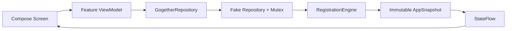

# Architecture

## 数据流

单一 `app` 模块，以 Feature Package 分工。`GogetherApplication` 在应用进程内持有唯一 Repository。页面依赖参数和回调，ViewModel 负责异步命令与操作反馈。`collectAsStateWithLifecycle` 将共享快照映射到可见 UI。没有页面自行保存报名名单或人数副本。

Explore 的 ViewModel 通过 `combine` 合并仓库快照、筛选条件与本地时钟；页面可在达到截止时刻时更新按钮。真正执行操作时，引擎再次读取时钟并校验，避免只依赖按钮是否启用。

## 事务边界

`FakeGogetherRepository.mutate` 使用 Mutex 串行执行本地命令。引擎在全部校验通过后才替换快照；取消、转正和通知使用同一个 `copy` 发布。UI 不会观察到“取消已生效、转正尚未生效”的中间结果。

这只适用于一个进程。正式后端必须将容量检查、唯一报名约束、取消、首位候补选择和通知记录放在可信事务中，并用幂等请求 ID 处理重试。客户端提交的 actor ID、队列顺序和时间不可信。

## 状态与约束

| 情境 | 引擎行为 |
| --- | --- |
| 创建活动 | 校验字段，组织者产生一条 CONFIRMED 报名，占一个名额 |
| OPEN、未开始且未截止 | 有空位则 CONFIRMED，否则 WAITLISTED |
| 已 CONFIRMED / WAITLISTED | 拒绝重复报名，无状态变更 |
| 正式参与者取消 | 标记 CANCELLED；若仍可报名，首位候补变为 CONFIRMED 并收到通知 |
| 候补取消 | 从有效队列移除，不释放正式名额 |
| 取消后重新报名 | 同一用户 / 活动记录复用 ID，重新分配 joinedAt 与队列序号，排到队尾 |
| now >= deadline | 禁止报名和补位；开始前仍允许参与者取消 |
| now >= start | 禁止新报名、参与者取消和组织者取消 |
| 活动 CANCELLED | 清除所有有效报名状态、关闭签到、通知所有原参与者；不补位 |
| COMPLETED 或超过 endAt | 禁止新报名 / 签到，允许合格参与者提交一次反馈 |

队列使用单调递增 `queueOrder`，保证同一毫秒加入时也有明确顺序。正式人数和候补人数从报名记录派生，避免重复字段失配。`RegistrationStatus.REJECTED` 是预留状态；第一阶段失败命令返回 `Result.failure`，不保存被拒绝记录。

## 时间、签到与反馈

所有模型时间用 epoch milliseconds。表单严格解析设备时区的 `YYYY-MM-DD` 和 `HH:mm`，拒绝不存在的日期以及夏令时重叠 / 跳过的模糊时间。创建表单明确显示时区。事件持续时间暂定两小时，终止时间到达后即按已结束处理；本地不会自动把存储的 OPEN 重写为 COMPLETED。

Demo 签到要求组织者开启、活动未取消 / 未结束、当前用户正式报名以及此前没有签到。为排练允许活动开始前开启；正式版本需要服务器时间窗口、动态凭据与身份校验。签到记录保留审计信息，若之后活动取消，记录不会被删除。

已结束活动的正式参与者可提交一次 1–5 分和最多 500 字评论；第一阶段不要求签到才可反馈，此规则需由小组确认后再用于正式后端。

## 生命周期与依赖

Activity 旋转不重建 Application Repository。登录态、数据均不写磁盘，进程重启重新生成六个用户、五个未来活动和一个历史活动。切换用户重新建立导航与表单组合，不会将旧页面继续作为新用户的操作上下文。

保持手动构造依赖；暂不引入 Hilt、Room、网络客户端、图片加载库或多模块结构。后端实现由 Application 注入，UI 保持面向接口。接口目前以整份快照简化 MVP；后续可按功能拆分流，但应保留跨记录事务一致性。
